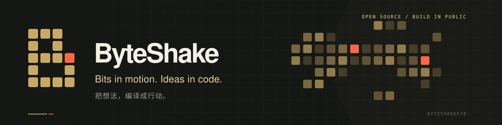

<div align="center">
  
</div>

# Hi, we’re ByteShake678.

**We turn rough ideas into working software.**

ByteShake678 is a small, open-source software studio. We make useful tools, run honest experiments, and document what we learn along the way.

**做能运行的东西，留下可复用的方法。**

[](#what-we-build)
[](#how-we-work)
[](#how-we-work)

---

## What we build

<table>
  <tr>
    <td width="33%" valign="top">
      <h3>Useful tools</h3>
      <p>Start from a real problem and ship something people can actually run.</p>
      <sub><code>SHIP / LEARN / ITERATE</code></sub>
    </td>
    <td width="33%" valign="top">
      <h3>Open experiments</h3>
      <p>Keep the prototype, the method, and the lessons visible.</p>
      <sub><code>DOCUMENT / REUSE / SHARE</code></sub>
    </td>
    <td width="33%" valign="top">
      <h3>Clear communication</h3>
      <p>Make code, docs, and design speak the same language.</p>
      <sub><code>SIMPLE / VISIBLE / HUMAN</code></sub>
    </td>
  </tr>
</table>

## How we work

- **Small enough to move.** Prefer a clear prototype over an abstract grand plan.
- **Open enough to reuse.** Publish the decisions, not only the final code.
- **Useful enough to matter.** Judge the work by whether it solves a real problem.

## Projects

The first public projects are being prepared. When they land, each repository will open with the same compact README structure:

```text
What it does       → one sentence
Try it             → install or live link
Why it exists      → the concrete problem
How it works       → the smallest useful architecture
Status             → experimental / usable / maintained
```

## Work with us

Found a bug, have a reproducible idea, or want to collaborate?

Open an issue in the relevant repository. For private or cross-project topics, use the contact method listed on the organization page.

<div align="center">
  <sub><strong>BYTESHAKE678</strong> · SHAKE THE BITS. SHIP THE IDEA.</sub>
</div>
